# Parking Space Reservation Chatbot

An AI-powered parking space reservation chatbot built using **Python, LangGraph, LangChain, PostgreSQL, Weaviate, and OpenAI**.

The application supports parking information retrieval, reservation workflows, booking validation, privacy-aware handling of customer information, and human administrator approval through email integration.

---

## 1. Project Overview

The Parking Space Reservation Chatbot allows users to:

- Ask questions about parking facilities.
- Retrieve static parking information using a vector database.
- Check dynamic parking availability and pricing.
- Create parking reservation requests through a conversational workflow.
- Validate booking details before submitting reservations.
- Send reservation approval requests to a human administrator through email.
- Receive administrator approval or rejection through email.
- Create bookings only after administrator approval.
- Handle invalid booking requests and unavailable parking spaces.
- Protect personally identifiable information (PII) before sending data to an LLM.

The application uses **LangGraph** to manage conversational state and workflow execution.

It follows a two-agent architecture:

1. **Customer Agent:** Interacts with customers, collects reservation details, validates information, and manages the reservation workflow.
2. **Administrator Agent:** Uses LangChain to interpret administrator email responses and extract reservation approval decisions.

The two agents communicate through an email-based approval workflow using SMTP and IMAP.

---

## 2. Technology Stack

| Component | Technology |
|---|---|
| Programming Language | Python 3.11+ |
| Dependency Management | uv |
| LLM | OpenAI GPT-4o (configurable) |
| Embedding Model | OpenAI text-embedding-3-small |
| Agent Framework | LangGraph |
| LLM Framework | LangChain |
| Structured Output | Pydantic |
| Vector Database | Weaviate 1.27.0 |
| Relational Database | PostgreSQL 16 |
| Database Driver | psycopg 3 |
| PII Detection | Microsoft Presidio |
| PII Anonymization | Microsoft Presidio |
| NLP Model | spaCy en_core_web_lg |
| Email Integration | SMTP and IMAP |
| Email Interpretation | LangChain structured output |
| Containerization | Docker Compose |

---

## 3. Architecture

The application follows a multi-agent, workflow-based architecture.

### 3.1 High-Level Architecture

```text
                         Customer
                            |
                            v
                       CLI Interface
                            |
                            v
                    Customer Agent
                      (LangGraph)
                            |
                            v
                    PII Detection
                            |
                            v
                    Anonymization
                            |
                            v
                  Intent Classification
                            |
                            v
                    Workflow Router
                            |
             +--------------+--------------+
             |              |              |
             v              v              v
        Information     Availability    Reservation
         Retrieval         Check         Workflow
             |              |              |
             v              v              v
          Weaviate      PostgreSQL      Validation
                                           |
                                           v
                                    Price Quotation
                                           |
                                           v
                                  Customer Confirmation
                                           |
                                           v
                                  Administrator Agent
                                     (LangChain)
                                           |
                                           v
                                  Generate Approval
                                       Request
                                           |
                                           v
                                    SMTP Server
                                           |
                                           v
                                  Administrator Email
                                           |
                                           v
                                  Human Administrator
                                           |
                                     APPROVE / REJECT
                                           |
                                           v
                                     IMAP Server
                                           |
                                           v
                                  Administrator Agent
                                           |
                                           v
                                  Extract Decision
                                           |
                                           v
                                  Approval Validation
                                           |
                             +-------------+-------------+
                             |                           |
                             v                           v
                         APPROVED                     REJECTED
                             |                           |
                             v                           v
                       PostgreSQL                  Customer Agent
                       Booking Write                     |
                             |                           |
                             +-------------+-------------+
                                           |
                                           v
                                   Response Generation
                                           |
                                           v
                                         Customer
```

### 3.2 Customer Agent

The customer-facing agent is implemented using LangGraph.

Responsibilities:

- Handle customer conversations.
- Classify user intent.
- Retrieve static information from Weaviate.
- Retrieve dynamic information from PostgreSQL.
- Collect reservation details.
- Validate reservation information.
- Calculate reservation quotations.
- Request customer confirmation.
- Escalate confirmed reservation requests to the administrator.
- Create bookings after administrator approval.
- Inform customers about the final reservation status.

### 3.3 Administrator Agent

The administrator-facing agent is implemented using LangChain.

Responsibilities:

- Interpret administrator email responses.
- Extract reservation request IDs.
- Identify approval or rejection decisions.
- Extract administrator comments or rejection reasons.
- Validate the extracted request ID against the pending reservation request.
- Return a structured decision to the customer-facing workflow.

The administrator agent uses Pydantic structured output.

The decision schema supports three values:

| Decision | Description |
|---|---|
| APPROVE | Administrator explicitly approves the reservation |
| REJECT | Administrator explicitly rejects the reservation |
| UNCLEAR | Email response does not contain an unambiguous decision |

The administrator agent does not independently create reservations or determine parking availability.

### 3.4 Email Communication Workflow

The two agents communicate through an email-based approval mechanism.

**Sending approval requests**

- The customer agent collects and validates reservation details.
- A unique reservation approval request ID is generated.
- The administrator agent prepares the approval request.
- SMTP sends the email to the administrator.

**Receiving administrator responses**

- IMAP retrieves administrator replies.
- The email content is passed to the administrator agent.
- The administrator agent extracts the request ID and decision.
- The request ID is validated against the pending reservation.
- The decision is returned to the customer-facing workflow.

**Example administrator email**

Subject:

```text
Parking Reservation Approval Request [REQUEST_ID]
```

Example response:

```text
APPROVE: REQUEST_ID

Reason: Reservation approved.
```

Alternatively:

```text
REJECT: REQUEST_ID

Reason: Parking capacity is unavailable.
```

Only explicit approval or rejection decisions are accepted. Ambiguous responses are treated as UNCLEAR.

### 3.5 Reservation Approval Workflow

```text
Customer Requests Reservation
             |
             v
     Collect Reservation Details
             |
             v
       Validate Details
             |
             v
       Calculate Price
             |
             v
    Customer Confirms Quote
             |
             v
    Send Approval Request Email
             |
             v
    Wait for Administrator Reply
             |
             v
     Interpret Email Response
             |
             v
      Validate Request ID
             |
       +-----+-----+
       |           |
       v           v
    APPROVE      REJECT
       |           |
       v           v
  Create Booking  Inform Customer
       |
       v
  Booking Confirmation
```

---

## 4. Project Structure

```text
parking-chatbot/
│
├── docker-compose.yml
├── .env
├── pyproject.toml
├── uv.lock
│
├── db/
│   └── init/
│       ├── 01_schema.sql
│       ├── 02_functions.sql
│       ├── 03_triggers.sql
│       ├── 04_roles.sql
│       └── 05_seed.sql
│
├── ingestion/
│   └── ingest.py
│
├── app/
│   ├── config.py
│   ├── state.py
│   ├── models.py
│   ├── prompts.py
│   ├── db.py
│   ├── retrieval.py
│   ├── validators.py
│   ├── guardrails.py
│   │
│   ├── admin_agent.py
│   ├── admin_client.py
│   ├── admin_api.py
│   │
│   ├── nodes.py
│   ├── routers.py
│   └── graph.py
│
├── cli.py
│
├── evaluation/
│   ├── datasets/
│   ├── run_retrieval_eval.py
│   ├── run_latency.py
│   ├── run_guardrail_eval.py
│   ├── run_db_tests.py
│   └── report/
│
├── tests/
│   ├── test_db.py
│   ├── test_graph.py
│   ├── test_guardrails.py
│   ├── test_nodes.py
│   ├── test_retrieval.py
│   └── test_validators.py
│
└── knowledge/
    └── (Static facility knowledge files - to be added)
```

### Important Application Modules

| File | Responsibility |
|---|---|
| `config.py` | Application and environment configuration |
| `state.py` | Shared LangGraph conversation and approval state |
| `models.py` | Data models and structured schemas |
| `prompts.py` | LLM system prompts |
| `db.py` | PostgreSQL database operations |
| `retrieval.py` | Static information retrieval from Weaviate |
| `validators.py` | Reservation input validation |
| `guardrails.py` | Privacy and security guardrails |
| `admin_agent.py` | LangChain administrator decision agent |
| `admin_client.py` | SMTP email sending and IMAP email receiving |
| `admin_api.py` | Administrator email polling and response handling |
| `nodes.py` | Customer and administrator workflow integration |
| `routers.py` | Intent-based and approval-based routing |
| `graph.py` | LangGraph workflow construction |
| `cli.py` | Command-line chatbot interface |

---

## 5. Implementation Details

### 5.1 Infrastructure and Configuration

- Docker Compose configuration for running application services.
- Environment variable configuration through `.env`.
- Python project configuration using `pyproject.toml`.
- Dependency management using `uv`.
- PostgreSQL and Weaviate infrastructure.

### 5.2 Database Implementation

PostgreSQL database scripts:

| File | Responsibility |
|---|---|
| `01_schema.sql` | Database schema and tables |
| `02_functions.sql` | Database functions for reservation operations |
| `03_triggers.sql` | Database triggers and related rules |
| `04_roles.sql` | Database roles and access permissions |
| `05_seed.sql` | Sample facility and parking-space data |

PostgreSQL is responsible for dynamic facility information and reservation operations.

### 5.3 Vector Database and Ingestion

- Weaviate is used as the vector database.
- OpenAI `text-embedding-3-small` is used for embeddings.
- The ingestion script loads and processes Markdown documents.
- Static facility information is stored in Weaviate.
- Retrieval is performed using semantic search.

### 5.4 Customer Agent and LangGraph

The customer-facing agent manages the complete customer interaction.

The workflow includes:

- Conversation initialization.
- Human input handling.
- PII protection.
- Intent classification.
- Static retrieval.
- Dynamic PostgreSQL retrieval.
- Reservation field extraction.
- Reservation validation.
- Price quotation.
- Administrator approval escalation.
- Booking creation.
- Response generation.
- Transcript persistence.

### 5.5 Administrator Agent and LangChain

The administrator agent is implemented separately from the customer-facing agent.

It uses:

- `ChatOpenAI` for email interpretation.
- `ChatPromptTemplate` for administrator instructions.
- Pydantic `AdminDecision` for structured responses.
- `with_structured_output()` for extracting decisions.

Example structured response:

```python
AdminDecision(
    request_id="REQUEST_ID",
    decision="APPROVE",
    reason="Reservation approved."
)
```

The agent validates that the extracted request ID matches the expected pending request.

### 5.6 Email Integration

The email integration uses two communication protocols.

| Protocol | Purpose |
|---|---|
| SMTP | Send reservation approval requests |
| IMAP | Receive administrator email replies |

Implemented functionality:

- Generate unique approval request IDs.
- Send reservation details to the administrator.
- Include explicit approval and rejection instructions.
- Retrieve unread administrator emails.
- Verify the sender address.
- Extract email subject and body.
- Interpret administrator decisions.
- Validate request IDs.
- Return decisions to the customer agent.

Email configuration is maintained through environment variables.

### 5.7 Privacy and Security

The application includes an enhanced PII protection approach:

- Detect sensitive information before LLM processing.
- Mask customer names and vehicle registration numbers.
- Avoid sending raw PII to LLM requests, including embedding requests.
- Restore information locally when required for application operations.
- Keep customer and reservation records in PostgreSQL.
- Separate public facility information from private customer data.

Reservation details are sent through email to the configured administrator mailbox for approval. This is a separate communication channel from LLM processing.

Email credentials must be stored in environment variables and must never be committed to source control.

### 5.8 Reservation Business Rules

| Rule | Configuration |
|---|---|
| Booking interval | 30 minutes |
| Minimum duration | 1 hour |
| Maximum duration | 12 hours |
| Advance booking | Up to 14 days |
| Past reservations | Not allowed |
| Overnight booking | Not allowed |
| Currency | INR |
| Facility data | Sample data |

**Sample facility operating hours**

- Monday–Saturday: 06:00–22:00
- Sunday: 08:00–20:00

**Sample hourly pricing**

| Time period | Price |
|---|---:|
| 06:00–18:00 | ₹40/hour |
| 18:00–22:00 | ₹30/hour |

### 5.9 Administrator Approval States

The administrator approval workflow uses the following states:

| State | Description |
|---|---|
| NOT_REQUESTED | No approval request has been sent |
| PENDING | Approval request has been sent and is awaiting a response |
| APPROVED | Administrator approved the reservation |
| REJECTED | Administrator rejected the reservation |
| UNCLEAR | Decision could not be confirmed |

The booking workflow must check the administrator approval status before creating a reservation.

### 5.10 Evaluation Scripts

| Script | Purpose |
|---|---|
| `run_retrieval_eval.py` | Evaluate vector retrieval quality |
| `run_latency.py` | Measure application response latency |
| `run_guardrail_eval.py` | Evaluate PII detection and guardrails |
| `run_db_tests.py` | Test database reservation operations |

Evaluation metrics include:

- Recall@K
- Precision@K
- Hit Rate@K
- Mean Reciprocal Rank (MRR)
- Response latency

---

## 6. Environment Configuration

The application uses a `.env` file for configuration.

### 6.1 Administrator Email Configuration

Example Gmail configuration:

```dotenv
# Administrator email addresses
ADMIN_EMAIL_FROM=parkingbot@example.com
ADMIN_EMAIL_TO=admin@example.com

# SMTP configuration
SMTP_HOST=smtp.gmail.com
SMTP_PORT=587
SMTP_USERNAME=parkingbot@example.com
SMTP_PASSWORD=your_app_password
SMTP_USE_SSL=false
SMTP_STARTTLS=true

# IMAP configuration
IMAP_HOST=imap.gmail.com
IMAP_PORT=993
IMAP_USERNAME=parkingbot@example.com
IMAP_PASSWORD=your_app_password
IMAP_USE_SSL=true

# Email polling interval
ADMIN_EMAIL_POLL_INTERVAL=30
```

**Email setup requirements:**

1. Configure the sender email account.
2. Enable IMAP access for the mailbox.
3. Generate an application-specific password if using Gmail.
4. Configure the administrator's email address.
5. Keep email credentials private.

The same mailbox can be used for sending and receiving administrator approval messages.

---

## 7. Screenshots

Add screenshots here as the application is executed and tested.

### 7.1 Docker Services
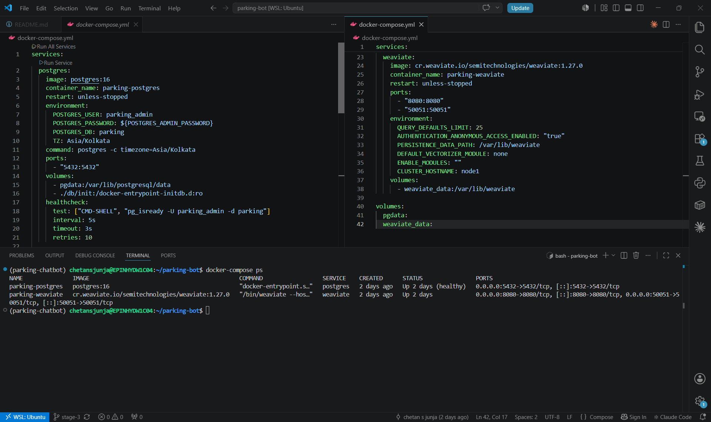

### 7.2 PostgreSQL Database
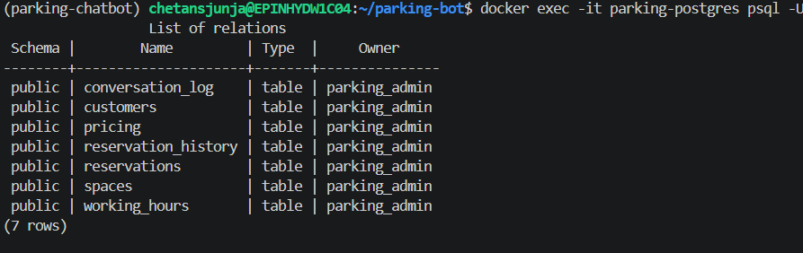

### 7.3 Weaviate Collection
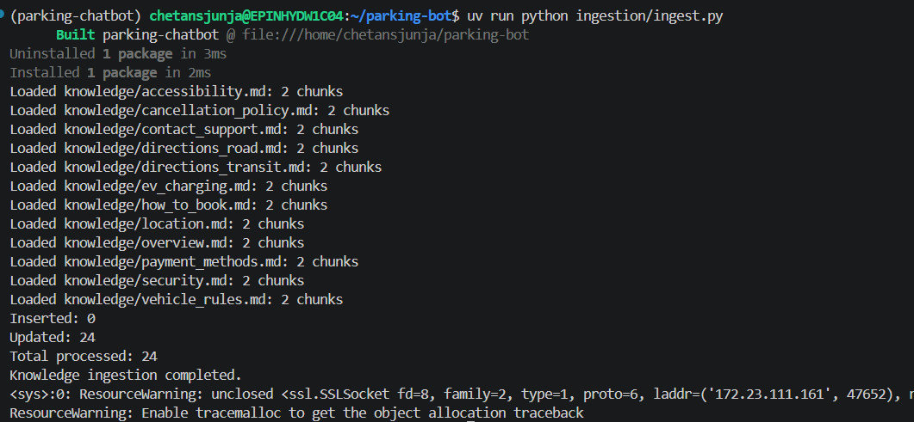

### 7.4 Chatbot Startup
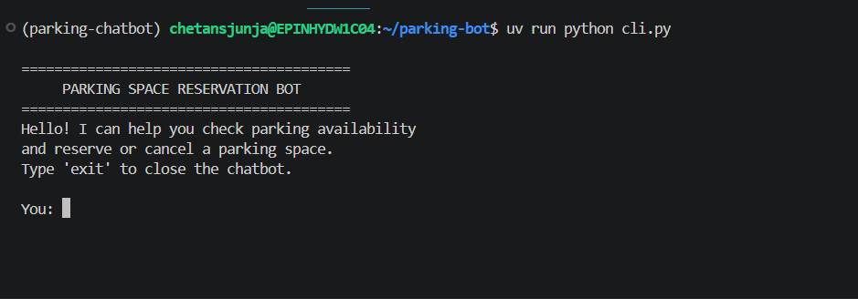

### 7.5 Parking Information Retrieval
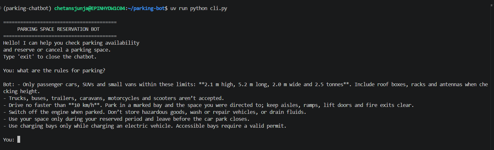

### 7.6 Customer Reservation Request
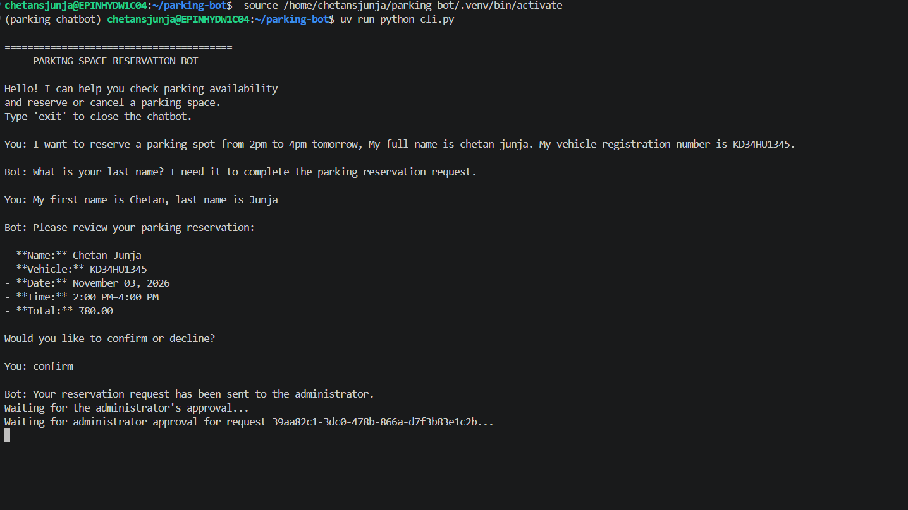

### 7.7 Administrator Approval Email
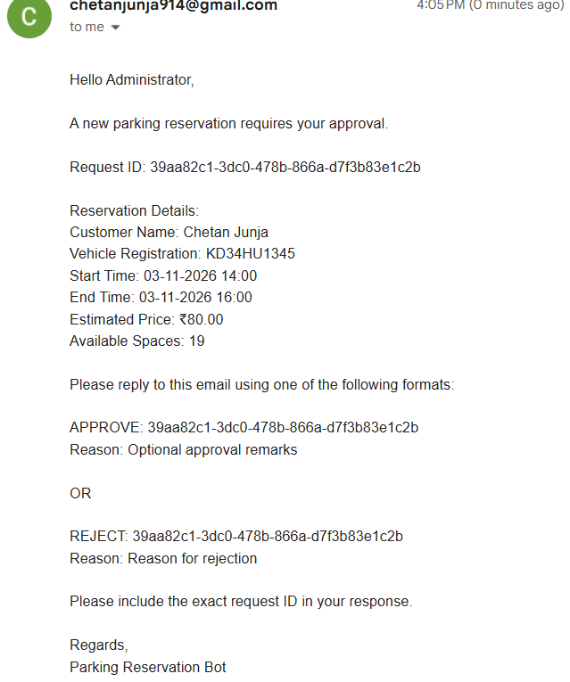

### 7.8 Administrator Approval Response
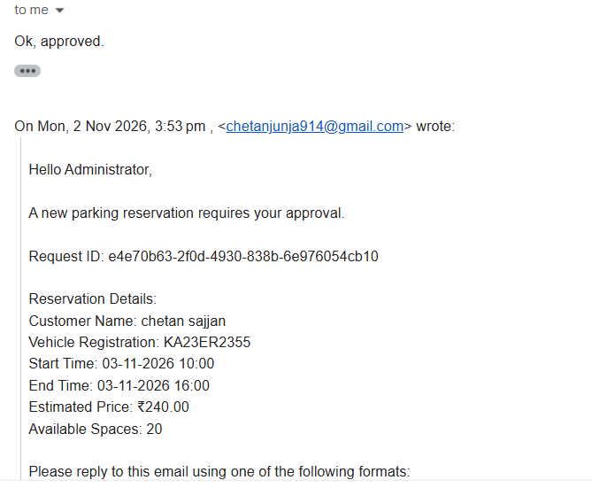

### 7.9 Successful Administrator Approval
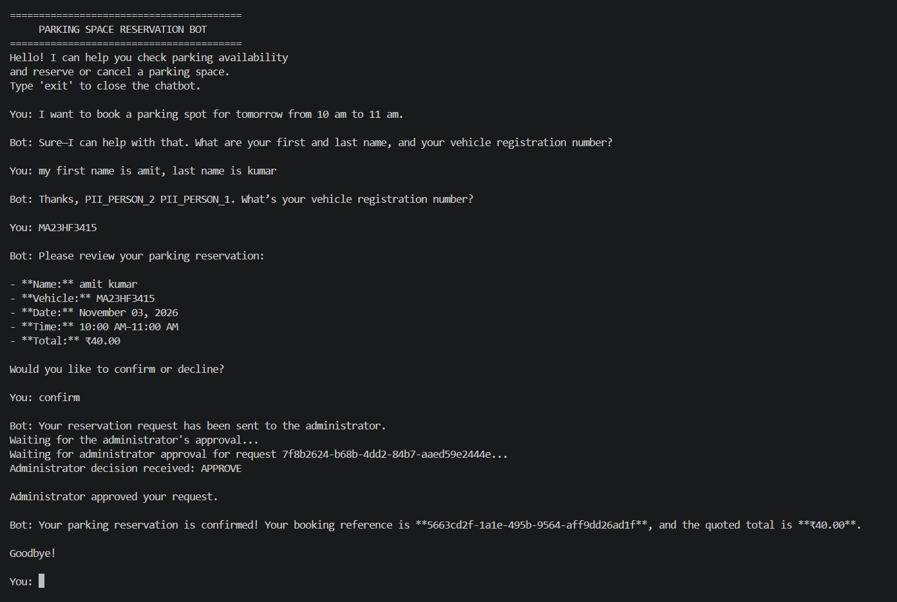

### 7.10 Administrator Rejection


### 7.11 Invalid Reservation Handling
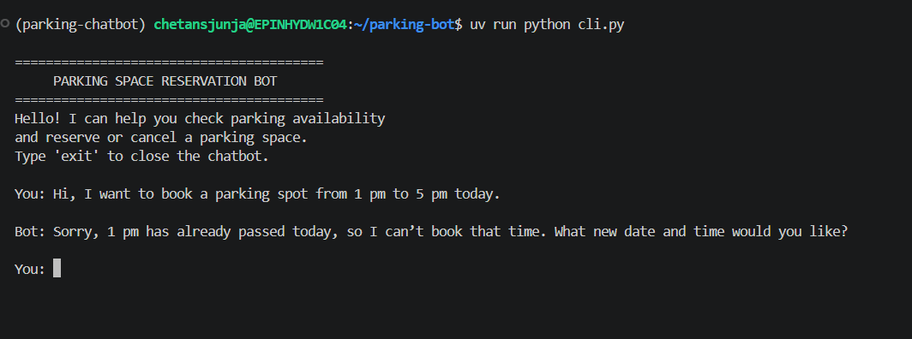

### 7.12 PII Protection
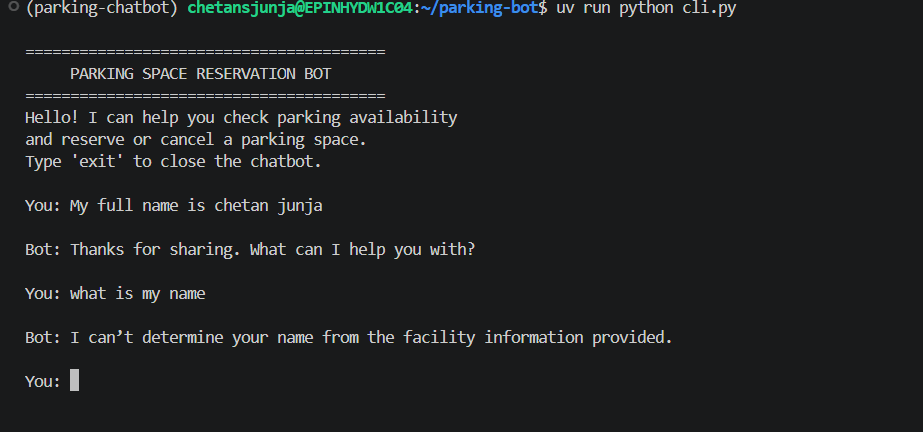


---

## 8. Sample Test Scenarios

The following scenarios can be used to test the chatbot.

| Scenario | Expected Result |
|---|---|
| General parking information request | Retrieve information from Weaviate |
| Parking availability request | Retrieve live availability from PostgreSQL |
| Parking pricing request | Return the configured pricing |
| Successful reservation request | Collect and validate all required details |
| Missing reservation details | Ask the customer for missing information |
| Invalid booking time | Reject invalid time and request correction |
| No parking spaces available | Inform the customer that no spaces are available |
| Customer confirms quotation | Send an approval request email |
| Administrator approves reservation | Create the booking in PostgreSQL |
| Administrator rejects reservation | Inform the customer that the request was rejected |
| Administrator sends unclear response | Do not create a booking |
| Incorrect request ID | Do not accept the administrator decision |
| Administrator does not respond | Keep the reservation unconfirmed |
| Duplicate administrator response | Ensure the same request is not booked twice |
| PII and prompt injection | Protect sensitive information and reject unsafe instructions |

Additional testing should cover cancellation, concurrent reservations, booking boundaries, retrieval quality, email delivery failures, and administrator response handling.

---

## 9. Running the Project

### Prerequisites

- Python 3.11+
- uv
- Docker and Docker Compose
- OpenAI API key
- Administrator email account with SMTP and IMAP access

### Step 1: Clone the repository

```bash
git clone <repository-url>
cd parking-chatbot
```

### Step 2: Configure environment variables

Update the `.env` file with:

- OpenAI API credentials.
- PostgreSQL configuration.
- Weaviate configuration.
- Administrator email addresses.
- SMTP credentials.
- IMAP credentials.

### Step 3: Install dependencies

```bash
uv sync
```

### Step 4: Start infrastructure services

```bash
docker compose up -d
```

### Step 5: Run the ingestion script

```bash
uv run python ingestion/ingest.py
```

### Step 6: Start the chatbot

```bash
uv run python cli.py
```

---

## 10. Conclusion

The Parking Space Reservation Chatbot combines conversational AI, retrieval-augmented generation, relational database operations, and human-in-the-loop approval.

The two-agent architecture separates customer interaction from administrator decision processing.

The customer-facing agent manages reservation collection and validation, while the administrator agent handles email-based approval and rejection decisions.

This ensures that reservation creation is subject to human administrator approval rather than being performed automatically based only on customer confirmation.