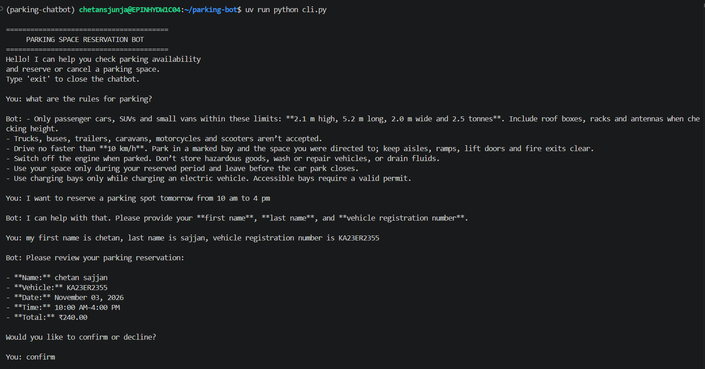

# Parking Space Reservation Chatbot

An AI-powered parking space reservation chatbot built using **Python, LangGraph, PostgreSQL, Weaviate, and OpenAI**. The application supports parking information retrieval, reservation workflows, booking validation, and privacy-aware handling of customer information.

---

## 1. Project Overview

The Parking Space Reservation Chatbot allows users to:

- Ask questions about parking facilities.
- Retrieve static parking information using a vector database.
- Check dynamic parking availability and pricing.
- Create parking reservations through a conversational workflow.
- Validate booking details before confirming reservations.
- Handle invalid booking requests and unavailable parking spaces.
- Protect personally identifiable information (PII) before sending data to an LLM.

The application uses LangGraph to manage conversational state and workflow execution.

## 2. Technology Stack

| Component | Technology |
|---|---|
| Programming Language | Python 3.11+ |
| Dependency Management | uv |
| LLM | OpenAI GPT-6-luna |
| Embedding Model | OpenAI text-embedding-3-small |
| Agent Framework | LangGraph |
| LLM Framework | LangChain |
| Vector Database | Weaviate 1.27.0 |
| Relational Database | PostgreSQL 16 |
| Database Driver | psycopg 3 |
| PII Detection | Microsoft Presidio |
| PII Anonymization | Microsoft Presidio |
| NLP Model | spaCy en_core_web_lg |
| Containerization | Docker Compose |

## 3. Architecture

The application follows a workflow-based architecture.

### High-level architecture

```text
                  User
                   |
                   v
             CLI Interface
                   |
                   v
             LangGraph Workflow
                   |
          +--------+--------+
          |                 |
          v                 v
     PII Detection     Intent Classification
          |                 |
          v                 v
     Anonymization      Workflow Router
                            |
              +-------------+-------------+
              |             |             |
              v             v             v
          Information   Availability   Reservation
           Retrieval      Check         Workflow
              |             |             |
              v             v             v
          Weaviate      PostgreSQL    Validation
              |             |             |
              +-------------+-------------+
                            |
                            v
                     Response Generation
                            |
                            v
                       User Response
```


### Screenshot: System Architecture

<!-- TODO: Add architecture diagram screenshot here -->


## 4. Project Structure

```text
parking-chatbot/
│
├── docker-compose.yml
├── .env
├── pyproject.toml
├── uv.lock
│
├── db/
│   └── init/
│       ├── 01_schema.sql
│       ├── 02_functions.sql
│       ├── 03_triggers.sql
│       ├── 04_roles.sql
│       └── 05_seed.sql
│
├── ingestion/
│   └── ingest.py
│
├── app/
│   ├── config.py
│   ├── state.py
│   ├── models.py
│   ├── prompts.py
│   ├── db.py
│   ├── retrieval.py
│   ├── validators.py
│   ├── guardrails.py
│   ├── nodes.py
│   ├── routers.py
│   └── graph.py
│
├── cli.py
│
├── evaluation/
│   ├── datasets/
│   ├── run_retrieval_eval.py
│   ├── run_latency.py
│   ├── run_guardrail_eval.py
│   ├── run_db_tests.py
│   └── report/
│
├── tests/
│   ├── test_db.py
│   ├── test_graph.py
│   ├── test_guardrails.py
│   ├── test_nodes.py
│   ├── test_retrieval.py
│   └── test_validators.py
└── knowledge/
      └── ....
```

## 5. Completed Implementation

The following components have been created so far.

### 5.1 Infrastructure and Configuration

- Docker Compose configuration for running the application services.
- Environment variable configuration through `.env`.
- Python project configuration using `pyproject.toml`.
- Dependency management using `uv`.

### 5.2 Database Implementation

PostgreSQL database scripts have been created for:

- `01_schema.sql` – Database schema and tables.
- `02_functions.sql` – Database functions for reservation operations.
- `03_triggers.sql` – Database triggers and related rules.
- `04_roles.sql` – Database roles and access permissions.
- `05_seed.sql` – Sample facility and parking-space data.

### 5.3 Vector Database and Ingestion

- Created the document ingestion script.
- Integrated Weaviate as the vector database.
- Integrated OpenAI embeddings using `text-embedding-3-small`.
- Prepared the ingestion workflow for static facility information.

### 5.4 LangGraph Application

The following application modules have been created:

| File | Responsibility |
|---|---|
| `config.py` | Application configuration and environment variables |
| `state.py` | Shared conversation state |
| `models.py` | Data models and structured schemas |
| `prompts.py` | LLM prompts |
| `db.py` | PostgreSQL database operations |
| `retrieval.py` | Static information retrieval from Weaviate |
| `validators.py` | Reservation input validation |
| `guardrails.py` | Privacy and security guardrails |
| `nodes.py` | LangGraph workflow nodes |
| `routers.py` | Intent-based workflow routing |
| `graph.py` | LangGraph workflow construction |

### 5.5 Privacy and Security

The application includes an enhanced PII protection approach:

- Detect sensitive information before LLM processing.
- Mask customer names and vehicle registration numbers.
- Avoid sending raw PII to LLM requests, including embedding requests.
- Restore information locally when required for application operations.
- Keep customer and reservation records in PostgreSQL.
- Separate public facility information from private customer data.

### 5.6 Reservation Business Rules

The application is designed around the following reservation rules:

| Rule | Configuration |
|---|---|
| Booking interval | 30 minutes |
| Minimum duration | 1 hour |
| Maximum duration | 12 hours |
| Advance booking | Up to 14 days |
| Past reservations | Not allowed |
| Overnight booking | Not allowed |
| Currency | INR |
| Facility data | Sample data |

**Sample facility operating hours**

- Monday–Saturday: 06:00–22:00
- Sunday: 08:00–20:00

**Sample hourly pricing**

| Time period | Price |
|---|---:|
| 06:00–18:00 | ₹40/hour |
| 18:00–22:00 | ₹30/hour |

### 5.7 Command-Line Interface

`cli.py` has been created as the entry point for interacting with the chatbot through a command-line interface.

### 5.8 Evaluation Scripts

The following evaluation scripts have been created:

| Script | Purpose |
|---|---|
| `run_retrieval_eval.py` | Evaluate vector retrieval quality |
| `run_latency.py` | Measure application response latency |
| `run_guardrail_eval.py` | Evaluate PII detection and guardrails |
| `run_db_tests.py` | Test database reservation operations |

Evaluation metrics include Recall@K, Precision@K, Hit Rate@K, MRR, and response latency.

---

## 6. Screenshots

Add screenshots here as the application is executed and tested.

### 6.1 Docker Services

<!-- TODO: Add screenshot showing running Docker containers -->


### 6.2 PostgreSQL Database

<!-- TODO: Add screenshot showing database tables and sample records -->


### 6.3 Weaviate Collection

<!-- TODO: Add screenshot showing the Weaviate collection and ingested objects -->


### 6.4 Chatbot Startup

<!-- TODO: Add screenshot showing chatbot startup in the terminal -->


### 6.5 Parking Information Retrieval

<!-- TODO: Add screenshot showing a parking information question and response -->


### 6.6 Successful Reservation

<!-- TODO: Add screenshot showing a completed reservation -->



### 6.7 Invalid Reservation Handling

<!-- TODO: Add screenshot showing validation of invalid booking details -->


### 6.8 PII Protection

<!-- TODO: Add screenshot showing sensitive information being masked -->


### 6.9 Evaluation Results

<!-- TODO: Add screenshot showing evaluation output and metrics -->


---

## 7. Sample Test Scenarios

The following scenarios can be used to test the chatbot.

| Scenario | Expected Result |
|---|---|
| Successful parking reservation | Reservation is created successfully |
| Missing reservation details | Chatbot asks for the missing information |
| Invalid booking time | Chatbot rejects the invalid time and requests correction |
| No parking spaces available | Chatbot informs the user that no spaces are available |
| PII and prompt injection | Sensitive information is protected and malicious requests are rejected |

Additional testing should cover cancellation, concurrent reservations, booking boundaries, and retrieval quality.

## 8. Running the Project

### Prerequisites

- Python 3.11+
- uv
- Docker and Docker Compose
- OpenAI API key

### Step 1: Clone the repository

```bash
git clone <repository-url>
cd parking-chatbot
```

### Step 2: Configure environment variables

Update the `.env` file with the required configuration and API credentials.

### Step 3: Install dependencies

```bash
uv sync
```

### Step 4: Start infrastructure services

```bash
docker compose up -d
```

### Step 5: Run the ingestion script

```bash
uv run python ingestion/ingest.py
```

### Step 6: Start the chatbot

```bash
uv run python cli.py
```

*Note: These are the intended project startup steps. Confirm the configured environment variables, service health, and database initialization before running the application.*

---
